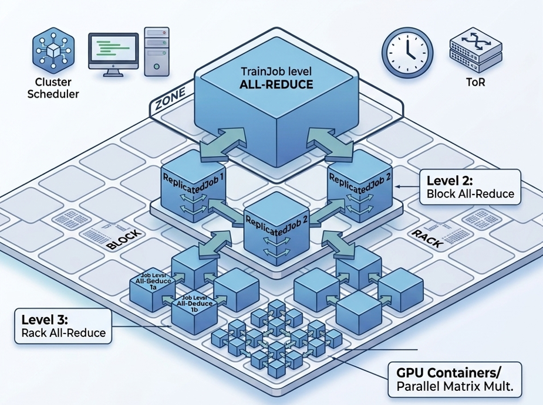
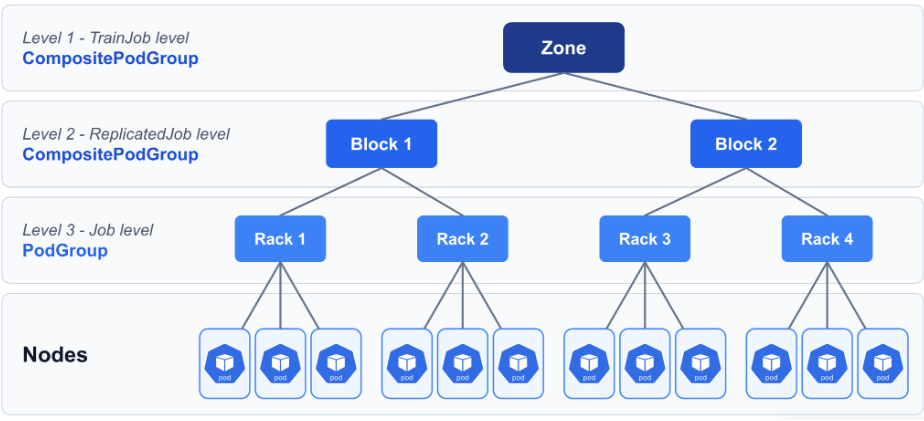

Imagine launching an AI/ML distributed training job across 64 GPUs. Two frequent problems happen:

1. **Idle Resource Trap:** The cluster finds capacity for 63 GPUs and sits idle waiting for the 64th to join, wasting massive resources and increasing the cost. Progress is zero. 
2. **Dependency Deadlock:** Suppose your training pipeline requires one initializer (to download datasets) and 64 GPU workers (to train). Kubernetes allocates all 64 GPUs to the workers within your quota, so the initializer cannot be scheduled. The workers cannot start without the data, and the initializer cannot be scheduled without capacity: a deadlock.

Standard Kubernetes struggles with AI/ML distributed training (data/model parallelism) that needs the jobs/tasks to be done via groups/gangs of pods. 

To solve these problems, the Kubernetes community introduced the Workload API, which brings gang scheduling, topology-aware scheduling, workload-aware preemption, DRA integration, and more through the `Workload`, `PodGroup`, and `CompositePodGroup` objects.


In this blog, we walk you through why TrainJob adopts Workload-Aware Scheduling (WAS), why it matters for AI/ML distributed training, and the architectural tradeoffs and future work involved. TrainJob implements WAS at three levels, and we explain each level and the reasoning behind it.

You’ll also learn how it simplifies the workflow for both data scientists and platform engineers to avoid boilerplate code.


---

## Why is WAS Important for TrainJob?

By default, `kube-scheduler` uses a greedy approach, trying to schedule pods one at a time instead of planning for the whole group. It has no native understanding of PyTorch, TrainJobs, or the needs of distributed ML training, where all pods must be scheduled together and may have specific placement requirements, such as running on the same rack.

To bridge this gap, Kubernetes SIG-Scheduling started a `Workload-Aware Scheduling (WAS)` working group to establish WAS building blocks: `Workload`, `PodGroup`, and `CompositePodGroups`. However, these building blocks require actual workload owners like the TrainJob controller to create such resources.

The `TrainJob` controller creates Workload objects to guide `kube-scheduler` on how to admit the pods as a unified group, enforcing all-or-nothing gang scheduling so expensive GPUs are never wasted, alongside `topology-aware scheduling` for low communication latency.

Best of all, Trainer APIs hide these complex, low-level scheduling resources from data scientists: practitioners simply specify `numNodes` in their `TrainJob` while platform administrators pre-configure `ClusterTrainingRuntime` with the desired scheduling configuration.

---

## Hierarchical Scheduling 

To understand the three levels, we must look at how Kubernetes scheduling aligns with the physical reality of an AI data center.

In distributed training, GPU workers communicate constantly to synchronize gradients. If communicating GPUs are placed across distant servers or cloud zones, network latency explodes and training throughput degrades significantly.

Kubeflow Trainer v2.4 introduces a 3-tier hierarchy to map software jobs to physical hardware topology:



*TrainJob Multi-Tier Scheduling Topology across Zone, Block, and Rack domains*


### Level 1 - TrainJob Level (Zone)
- **Kubernetes Object:** `PodGroup` in v2.4 (`CompositePodGroup` planned)
- **Physical Domain:** Cloud Zone (`topology.kubernetes.io/zone`)
- **Why it's needed:** Treats the entire training job as a single unit. It ensures all workers are located within the same cloud zone, avoiding cross-zone latency and bandwidth charges. Ideal for uniform workloads (e.g., PyTorch DDP).
- **User Story: Distributed PyTorch Training with Gang Scheduling:**
>**As a platform engineer**, I want to run a distributed PyTorch TrainJob with 100 nodes that must all be scheduled together. If only 99 workers can be scheduled, no pods should start.

### 1. ClusterTrainingRuntime and TrainJob Definitions

```yaml
apiVersion: trainer.kubeflow.org/v1alpha1
kind: ClusterTrainingRuntime
metadata:
  name: torch-distributed
spec:
  mlPolicy:
    numNodes: 1
    torch: {}
  scheduling: {}  # Enable workload-aware scheduling!
  template:
    spec:
      replicatedJobs:
        - name: node
          template:
            metadata:
              labels:
                trainer.kubeflow.org/trainjob-ancestor-step: trainer
            spec:
              template:
                spec:
                  containers:
                    - name: node
                      image: pytorch/pytorch:2.15.0-cuda13.4-cudnn9-runtime
---
apiVersion: trainer.kubeflow.org/v1alpha1
kind: TrainJob
metadata:
  name: my-job
spec:
  runtimeRef:
    name: torch-distributed
  trainer:
    image: docker.io/torch-run
    numNodes: 100
    resourcesPerNode:
      requests:
        nvidia.com/gpu: 4
```

### 2. Workload Resource Created by TrainJob Controller

```yaml
apiVersion: scheduling.k8s.io/v1beta1
kind: Workload
metadata:
  name: my-job-<hash>
  ownerReferences:
    - apiVersion: trainer.kubeflow.org/v1alpha1
      kind: TrainJob
      name: my-job
      controller: true
spec:
  controllerRef:
    apiGroup: trainer.kubeflow.org
    kind: TrainJob
    name: my-job
  podGroupTemplates:
    - name: my-job
      schedulingPolicy:
        gang:
          minCount: 100 # Computed from trainJob.spec.trainer.numNodes
```

### 3. Automatically Generated PodGroup by the TrainJob controller

```yaml
apiVersion: scheduling.k8s.io/v1beta1
kind: PodGroup
metadata:
  name: <workload-name>-<hash>
  ownerReferences:
    - apiVersion: trainer.kubeflow.org/v1alpha1
      kind: TrainJob
      name: my-job
      controller: true
spec:
  workloadRef:
    workloadName: <workload-name>
    templateName: my-job
  schedulingPolicy:
    gang:
      minCount: 100
```

### 4. Resulting Pod Spec Association

```yaml
spec:
  schedulingGroup:
    podGroupName: <workload-name>-<hash>
```


### Level 2 - ReplicatedJob Level (Network Block)
- **Kubernetes Object:** `PodGroup` in v2.4 (`CompositePodGroup` planned)
- **Physical Domain:** Network Block / Spine Switch
- **Why it's needed:** Prevents dependency deadlocks in multi-role pipelines. It allows platform engineers to give data initializers a basic policy (so they can run lazily on cheap nodes to download datasets), while allocating a coordinated gang policy for GPU workers once data is ready.
- **User Story:**

```yaml
apiVersion: trainer.kubeflow.org/v1alpha1
kind: ClusterTrainingRuntime
metadata:
  name: deepspeed-distributed
spec:
  mlPolicy:
    numNodes: 1
    mpi:
      numProcPerNode: 1
  scheduling:
    replicatedJobs:
      # The dataset initializer doesn't need GPUs, so it's scheduled individually.
      - targetReplicatedJobs: ["dataset-initializer"]
        schedulingPolicy:
          basic: {}
      # MPI launcher and workers are scheduled as one gang within the same zone.
      - targetReplicatedJobs: ["launcher", "node"]
        schedulingPolicy:
          gang: {}
        schedulingConstraints:
          topology:
            - key: topology.kubernetes.io/zone
  template:
    spec:
      replicatedJobs:
        - name: dataset-initializer
          ...
        - name: node
          dependsOn:
            - name: dataset-initializer
              status: Complete
          ...
        - name: launcher
          dependsOn:
            - name: node
              status: Ready
```

### Level 3 - Job / Per-Replica Level (Rack-Level)
- **Kubernetes Object:** `PodGroup`
- **Physical Domain:** Rack / Top-of-Rack Switch (`topology.kubernetes.io/rack`)
- **Why it's needed:** Maximum network throughput and failure isolation. Workers under the same Top-of-Rack (ToR) switch communicate at fast, non-blocking speeds. Each Job can also get its own DRA claims and failure boundary, the building block for Multi-Slice architectures (like TPU slices). In v2.4, the targeted ReplicatedJob can have at most 1 replica, since per-replica PodGroups require Kubernetes v1.38.


Given the above requirements, the TrainJob topology can be represented using the following WAS building blocks for each Level.



### Kubeflow Trainer v2.4 creates PodGroups at the level you choose

In v2.4, Trainer creates only `PodGroups`, and each `ReplicatedJob` is scheduled at exactly one level. Platform admins choose the level in the runtime's `spec.scheduling`.

### Introducing the Three Levels in TrainJob Topology

| Level | Configured In | PodGroups Created | When to Use |
| :--- | :--- | :--- | :--- |
| **Level 1: TrainJob** | `scheduling` | One `PodGroup` for all Pods of the `TrainJob` | All Pods must be scheduled, placed, and preempted as one unit (e.g., PyTorch DDP). |
| **Level 2: ReplicatedJob** | `scheduling.replicatedJobs[]` | One `PodGroup` per entry | ReplicatedJobs need different policies (e.g., basic policy for data initializers and gang policy for GPU workers). |
| **Level 3: Job** | `scheduling.replicatedJobs[].job` | One `PodGroup` per Job | Each Job needs its own gang, topology constraint, or DRA `resourceClaims` |

Each `PodGroup` is independent, so today the hierarchy has a single layer of `PodGroups` with no parent above them. That is already enough to solve both problems from the introduction:

- **Idle Resource Trap:**  A gang `PodGroup` admits all of its workers or none, so GPUs are never held while the job waits for the last worker.
- **Dependency Deadlock:**  At Level 2, the initializers get a basic `PodGroup` and start right away. The GPU workers wait in their own gang until all of them can be scheduled.


## Adopting CompositePodGroup - ROADMAP

`CompositePodGroup` is alpha in Kubernetes 1.37. Once Trainer adopts it, Levels 1 and 2 become CPGs, Level 3 stays a `PodGroup`, and the levels can be combined instead of choosing just one, as the diagram shows. This enables:

- **Gang of Gangs:**  A TrainJob-level CPG admits several Job-level gangs together or not at all. An example is multiple TPU slices, each with its own DRA claims.

- **Nested Topologies:** Each level keeps its own placement constraint. For example, the whole `TrainJob` stays in one zone, each `ReplicatedJob` in one network block, and each Job in one rack.

- **Mixed Policies in One Tree:**  The initializers keep a `basic` policy, while a parent gang keeps the GPU worker gangs together.


In short: today you choose between one big gang and several independent ones. With CPG, Trainer can express "all of these gangs, together, close to each other".

To learn more about Workload-Aware Scheduling in Trainer, check out the [docs](https://trainer.kubeflow.org/en/latest/operator-guides/workload-aware-scheduling.html) and follow the progress in [KEP-3015](https://github.com/kubeflow/trainer/tree/master/proposals/3015-workload-aware-scheduling).

---

## Other Feature Highlights in Trainer v2.4 

Beyond Workload-Aware Scheduling, Kubeflow Trainer v2.4 includes:
- **Per-TrainJob `schedulerName` overrides** ([#4265](https://github.com/kubeflow/trainer/pull/4265))
- **Job replicas for multi-slice TPU training** ([#4250](https://github.com/kubeflow/trainer/pull/4250))
- **Secured metrics endpoint** with TLS and RBAC-based auth ([#3912](https://github.com/kubeflow/trainer/pull/3912))
- **Prometheus monitoring overlay** ([#4102](https://github.com/kubeflow/trainer/pull/4102))
- **PyTorch 2.15 and CUDA 13.4** in the default runtimes ([#4369](https://github.com/kubeflow/trainer/pull/4369))


### Dynamic Resource Allocation (DRA)
Trainer 2.4 adds support for attaching accelerators and other specialised hardware to TrainJobs using Kubernetes Dynamic Resource Allocation (DRA) API (GA in kubernetes 1.34).

- DRA provides a more flexible way to request and attach hardware to TrainJobs, complementing traditional extended resource requests such as `nvidia.com/gpu: 1`. Unlike extended resources, DRA supports more advanced device selection, sharing, and allocation policies, giving users greater control over how hardware is assigned to training workloads.

- To learn more about using DRA in Kubeflow Trainer, check out the [Dynamic Resource Allocation (DRA) docs](https://trainer.kubeflow.org/en/latest/operator-guides/dynamic-resource-allocation.html).

### OptimizationJob Alpha Integrations
- **Declarative HPO:** Enables the `OptimizationJob` -> `TrainJob` hierarchy, leveraging TrainJob's native progress tracking to eliminate the legacy Katib DB dependency.
- **Getting Started:** Enable the `OptimizationJob` and `TrainJobStatus` alpha feature gates ([#4331](https://github.com/kubeflow/trainer/pull/4331)) and follow the [OptimizationJob user guide](https://trainer.kubeflow.org/en/latest/user-guides/optimizationjob.html).
- **CEL-Native Validation:** Implements server-side CEL validation for `SearchSpace` and `TrialConfig` constraints, ensuring high-quality hyperparameter search configurations at the API layer.
- [OptimizationJob KEP-3562](https://github.com/kubeflow/trainer/tree/master/proposals/2605-optimization-job-crd)


### Release Notes: [Kubeflow Trainer v2.4.0 Changelog](https://github.com/kubeflow/trainer/releases/tag/v2.4.0)


---

## Breaking Changes & Upgrade Notices (v2.4)

1. **ReplicatedJob Name Length at 20 Characters ([#4391](https://github.com/kubeflow/trainer/pull/4391))**  
`TrainingRuntimes` and `ClusterTrainingRuntimes` with `ReplicatedJob` names longer than 20 characters are rejected on creation and on updates that modify `spec.template`.


2. **CertManagement Configuration Fields Renamed ([#3386](https://github.com/kubeflow/trainer/pull/3386))**  
Renames the `CertManagement` configuration fields from webhook-specific names to generic names, since the TLS certificate is used by the metrics server and the status server in addition to webhooks. 

3. **TrainJob image synchronization for MPI Runtimes ([#4301](https://github.com/kubeflow/trainer/pull/4301))**  
For MPI runtimes, `Trainjob spec.trainer.image` now configures the image for both the worker nodes and the launcher pod. Previously it only configured the launcher pod.


4. **Helm manifests retain CRDs on uninstall ([#4122](https://github.com/kubeflow/trainer/pull/4122))**  
Helm charts now keep the Custom Resource Definitions (CRDs) on `helm uninstall` (`crds.keep: true` by default), since deleting a CRD deletes every TrainJob, TrainingRuntime, ClusterTrainingRuntime, and OptimizationJob in the cluster. Set `crds.keep=false` to remove the CRDs with the release. 

5. **Enabling Data Cache in Helm Chart no longer automatically installs LWS subchart ([#4120](https://github.com/kubeflow/trainer/pull/4120))**  
When data cache is enabled, the Helm chart no longer automatically installs the LeaderWorkerSet (LWS) dependency. Users who rely on the chart to install LWS must explicitly set `dataCache.lws.install=true`. This allows users with an existing LWS installation to enable data caching without installing LWS again.

6. **MPI runtimes emit PRTE env vars for Open MPI 5 ([#4029](https://github.com/kubeflow/trainer/pull/4029))**  
Suspended TrainJobs that use the MPI plugin (e.g., DeepSpeed, MLX) and were created before the upgrade fail to resume after upgrading to v2.4, because the new `PRTE_MCA_*` env vars can't be applied to the existing immutable JobSet. Wait for MPI-based TrainJobs to complete before upgrading, or recreate them after the upgrade.


---

## References

1. [Proposal for Integration of WAS with TrainJob Controller](https://github.com/kubeflow/trainer/tree/master/proposals/3015-workload-aware-scheduling)

2. [Gang Scheduling using Workload Object](https://github.com/kubernetes/enhancements/blob/master/keps/sig-scheduling/4671-gang-scheduling/README.md)

3. [Workload API](https://kubernetes.io/docs/concepts/workloads/workload-api/)

4. [How to Use Workload API in TrainJob Controller](https://trainer.kubeflow.org/en/latest/operator-guides/workload-aware-scheduling.html)


## Join the Community
The Kubeflow Trainer is built by and for the community. We welcome contributions, feedback, and participation from everyone! We want to thank the community for their contributions to this release. We invite you to:

### Contribute:
- Read the [Contributing Guide](https://github.com/kubeflow/trainer/blob/master/CONTRIBUTING.md).
- Browse the good first issues
- Explore the GitHub Repository

### Connect with the Community:
- Join [#kubeflow-trainer](https://cloud-native.slack.com/archives/C0742LDFZ4K) on CNCF Slack
- Attend our biweekly [Kubeflow Trainer meetings](https://bit.ly/kf-trainer-meeting)

### Learn More:
- View the [GitHub Release](https://github.com/kubeflow/trainer/releases/tag/v2.4.0)
- Explore the [Kubeflow Trainer docs](https://trainer.kubeflow.org/)