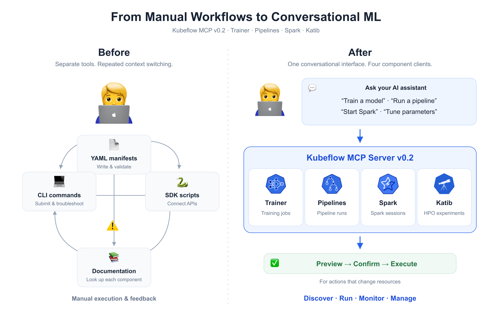
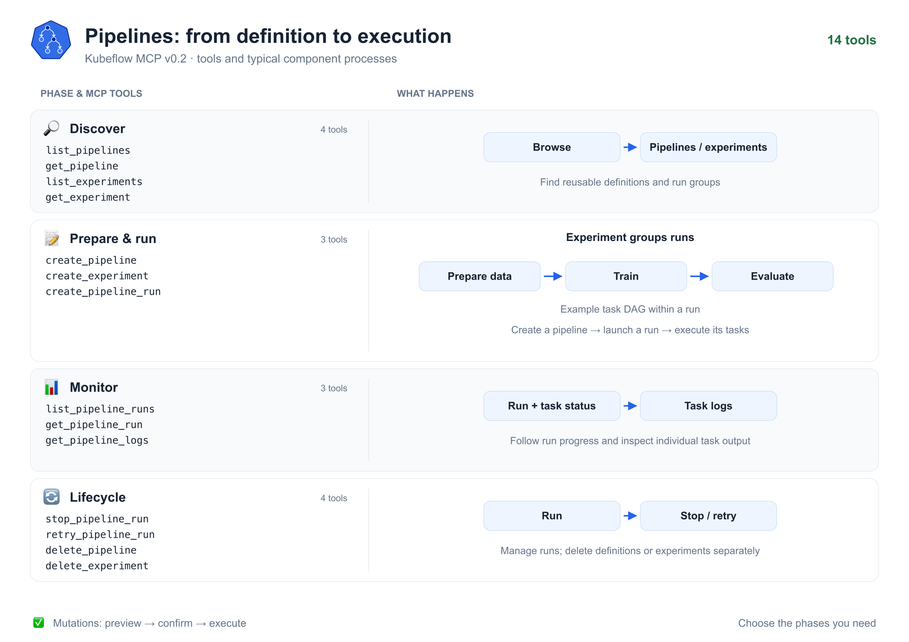
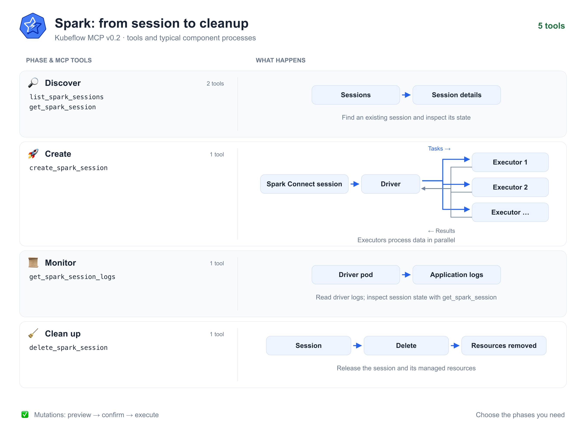
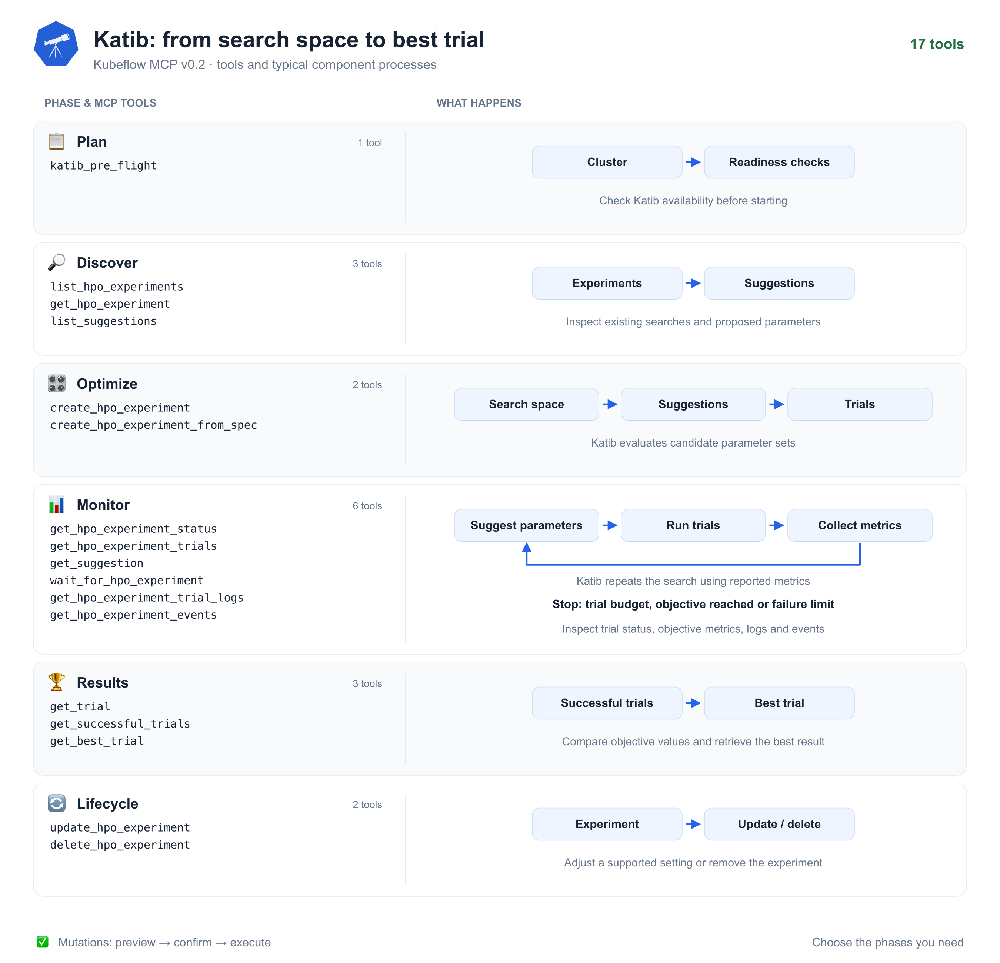

AI agents are rapidly becoming a standard interface for operating software systems, yet machine learning infrastructure remains fragmented across separate APIs, SDKs, and operational workflows. The **Kubeflow MCP Server** bridges that gap through the [Model Context Protocol (MCP)](https://modelcontextprotocol.io/), giving AI agents a consistent, safety-first way to discover capabilities, execute workloads, and monitor clusters.

With **v0.2**, the server expands from a Trainer-focused integration into a **multi-client platform**:

- **3 new Kubeflow clients:** Pipelines (14 tools), Spark (5 tools), and Optimizer / Katib (17 tools)—growing the server from 23 to **59 tools**.
- **Richer Trainer diagnostics:** GPU allocation previews, pod blockers, per-step status, cursor-based log polling, and full confirm-gate coverage.
- **Modern protocol core:** Upgraded to **FastMCP 4**, **MCP SDK v2**, and **Kubeflow SDK 0.5.0**.
- **Hardened safety & ecosystem:** Strict JWT auth, fail-closed policies, deployment/observability profiles, and a GitHub-hosted **Agent Skills catalog** skeleton.

{: style="border: 1.5px solid #334155; border-radius: 8px;" }

One MCP server, multiple Kubeflow clients, and a unified interface for AI agents. Let's walk through what's new and how to get started.

---

## What's New in v0.2?

The biggest change in v0.2 is the expansion from a single-client Trainer server into a modular multi-client architecture, letting users enable only the Kubeflow components installed on their cluster.

| Client | CLI Flag | Status | Tools | Description |
|---|---|---|---:|---|
| **Kubeflow Trainer** | `--clients trainer` *(default)* | Available *(enhanced in v0.2)* | 21 *(+ 2 shared health tools = 23)* | Distributed training, fine-tuning, resource previews, pod diagnostics, and runtime management |
| **Kubeflow Pipelines** | `--clients pipelines` | New in v0.2 | 14 | Pipeline authoring, discovery, experiments, run execution, monitoring, and lifecycle |
| **Spark** | `--clients spark` | New in v0.2 | 5 | SparkConnect session discovery, provisioning, driver logs, and teardown |
| **Optimizer (Katib)** | `--clients optimizer` | New in v0.2 | 17 | Katib pre-flight checks, HPO experiment creation, trial monitoring, and lifecycle |

The Trainer client remains the default foundation (with two shared server-level health tools, `health_check` and `get_server_logs`, always available), while **Pipelines**, **Spark**, and **Optimizer (Katib)** add 36 new tools for a total of **59 tools** across four active clients.

---

## Multi-Client Architecture

The v0.2 architecture centers on a single MCP Server process (`kubeflow-mcp serve`) that dynamically loads client modules and applies shared security, policy, resilience, and observability layers to every tool call.

- **Modular client ownership:** Each client packages its own tools, workflow phases, instruction sections, and `client://guides/*` MCP resources.
- **Shared server core:** Every loaded client automatically inherits authentication, persona gating, audit logging, rate limiting, and circuit breakers.

---

## Key Features

### Kubeflow Pipelines Client (14 Tools)

The **Kubeflow Pipelines Client** wraps `kubeflow.pipelines.PipelinesClient` (`kubeflow-mcp[pipelines]`). Beyond discovering and running existing pipelines, v0.2 includes **pipeline authoring** and **experiment management** so agents can go from prompt to registered pipeline to tracked run.

| Phase | Tools | What they do |
|---|---|---|
| **Discovery** | `list_pipelines`, `get_pipeline`, `list_experiments`, `get_experiment` | Browse registered pipelines, versions, and experiments |
| **Authoring** | `create_pipeline` | Validate, compile, and upload KFP v2 Python pipelines |
| **Monitoring** | `list_pipeline_runs`, `get_pipeline_run`, `get_pipeline_logs` | Follow runs, inspect task states, and read task pod logs |
| **Runs** | `create_pipeline_run`, `create_experiment` | Start pipeline runs and create experiments |
| **Lifecycle** | `stop_pipeline_run`, `retry_pipeline_run`, `delete_experiment`, `delete_pipeline` | Stop or retry runs, or delete experiments and pipelines |

{: style="border: 1.5px solid #334155; border-radius: 8px;" }

- **Sandboxed authoring:** `create_pipeline` AST-validates KFP v2 Python code and compiles it in an isolated `python -I` subprocess before uploading.
- **Role-based guards:** Since KFP does not support MCP ownership labels, authoring and stop/retry require `ml-engineer`, while deletes require `platform-admin`.

**Example interaction:**

```text
User: "List our pipelines and start a run of the customer-churn pipeline."

1. Agent calls list_pipelines()
   → Returns registered pipelines including "customer-churn"

2. Agent calls get_pipeline(name="customer-churn")
   → Inspects latest version and expected parameters

3. Agent calls create_pipeline_run(pipeline="customer-churn",
                                   experiment="weekly-eval",
                                   confirmed=False)
   → Returns preview of the run configuration for review

4. User: "Looks good, run it."
   Agent calls create_pipeline_run(..., confirmed=True)
   → Starts pipeline run and returns run_id

5. Agent calls get_pipeline_run(run_id="<run-id>")
   → Tracks task states; calls get_pipeline_logs() if any task fails
```

---

### Spark Client (5 Tools)

The **Spark Client** wraps `kubeflow.spark.SparkClient` (via `kubeflow-mcp[spark]`) to manage **SparkConnect** sessions on Kubernetes. It handles session provisioning and returns connection info so PySpark attaches directly without proxying Spark RPCs.

| Phase | Tools | What they do |
|---|---|---|
| **Discovery** | `list_spark_sessions`, `get_spark_session` | Browse SparkConnect sessions, driver pods, and connect info |
| **Sessions** | `create_spark_session`, `delete_spark_session` | Provision and tear down MCP-managed SparkConnect sessions |
| **Monitoring** | `get_spark_session_logs` | Read bounded Spark driver-pod logs |

{: style="border: 1.5px solid #334155; border-radius: 8px;" }

**Example interaction:**

```text
User: "Show me the currently available Spark sessions and check the logs for spark-etl-dev."

1. Agent calls list_spark_sessions()
   → Returns active SparkConnect sessions and states (Ready / Provisioning / Failed)

2. Agent calls get_spark_session(name="spark-etl-dev")
   → Returns driver pod status, service name, and SparkConnect endpoint

3. Agent calls get_spark_session_logs(name="spark-etl-dev", tail_lines=100)
   → Returns bounded driver logs for diagnostics
```

---

### Optimizer (Katib) Client (17 Tools)

The **Optimizer (Katib) Client** wraps `kubeflow.optimizer.OptimizerClient` (included in the base `kubeflow-mcp` install) to bring end-to-end hyperparameter optimization (HPO) workflows to AI agents.

| Phase | Tools | What they do |
|---|---|---|
| **Planning** | `katib_pre_flight` | Verify Katib CRD, controller readiness, and Trainer availability |
| **Discovery** | `list_hpo_experiments`, `get_hpo_experiment`, `get_hpo_experiment_status`, `get_trial`, `get_successful_trials`, `list_suggestions` | Browse experiments, trials, successful results, and suggestions |
| **Optimization** | `create_hpo_experiment`, `create_hpo_experiment_from_spec` | Create HPO experiments from flat parameters or a raw `V1beta1Experiment` spec |
| **Monitoring** | `get_hpo_experiment_trials`, `get_best_trial`, `get_suggestion`, `wait_for_hpo_experiment`, `get_hpo_experiment_trial_logs`, `get_hpo_experiment_events` | Track trials, fetch optimal hyperparameters, and inspect trial logs and events |
| **Lifecycle** | `update_hpo_experiment`, `delete_hpo_experiment` | Adjust trial budgets/parallelism or delete MCP-managed experiments |

{: style="border: 1.5px solid #334155; border-radius: 8px;" }

- **Flexible HPO creation:** `create_hpo_experiment` supports 7 built-in search algorithms (`random`, `grid`, `tpe`, `cmaes`, `sobol`, Bayesian, multivariate TPE); use `create_hpo_experiment_from_spec` for Hyperband, early stopping, or NAS.
- **Safe scaling:** Katib has no pause—lowering `parallel_trial_count` deletes active trials—so `update_hpo_experiment` is marked `[DESTRUCTIVE]`, restricted to `ml-engineer+`, and previews affected trials before confirmation.
- **Prerequisite:** Requires Katib `v0.19` and namespace label `katib.kubeflow.org/metrics-collector-injection=enabled`.

**Example interaction:**

```text
User: "Tune learning rate and batch size for my training job using TPE."

1. Agent calls katib_pre_flight()
   → Verifies Katib Experiment CRD and controller health

2. Agent calls create_hpo_experiment(name="lr-bs-sweep",
                                     algorithm="tpe",
                                     ...,
                                     confirmed=False)
   → Returns experiment preview with search space, objective, and trial budget

3. User: "Approved, start the sweep."
   Agent calls create_hpo_experiment(..., confirmed=True)
   → Creates Katib Experiment "lr-bs-sweep"

4. Agent calls wait_for_hpo_experiment("lr-bs-sweep")
   → Waits for the experiment to complete (or polls with get_hpo_experiment_status())

5. Agent calls get_best_trial("lr-bs-sweep")
   → Returns best hyperparameters and objective metric (ready to feed into fine_tune())
```

---

### Beyond New Clients: A Stronger Kubeflow MCP

Beyond the new integrations, v0.2 improves how agents interact with Kubeflow and how teams deploy and operate the server:

- **Consistent controls across clients:** Preview-and-confirm behavior covers mutating operations, while stricter JWT validation and fail-closed configuration help preserve access boundaries.
- **Better workload visibility:** Trainer adds GPU allocation reporting, per-step status, scheduling diagnostics, and incremental log retrieval. Trace-ID correlation helps operators follow requests through server logs and traces.
- **Updated protocol and SDK support:** FastMCP 4, MCP SDK v2, and Kubeflow SDK 0.5.0 update the server's integration foundation.
- **More deployment options:** Kubernetes, kagent, and agentgateway examples provide starting points for cluster deployments, with optional OpenTelemetry collection and Grafana dashboards.
- **A foundation for reusable skills:** The GitHub-hosted catalog establishes packaging for future Kubeflow workflow skills.

---

### Guided Workflows & Token-Efficient Modes

Every client organizes its tools into logical workflow phases and injects `_meta.phase` and `_meta.next` workflow hints (automatically withheld when blockers or preview gates are returned):

| Client | Workflow Phases |
|---|---|
| **Trainer** | Planning, Discovery, Training, Monitoring, Lifecycle, Platform *(+ server-level Health)* |
| **Pipelines** | Discovery, Authoring, Monitoring, Runs, Lifecycle |
| **Spark** | Discovery, Sessions, Monitoring |
| **Optimizer (Katib)** | Planning, Discovery, Optimization, Monitoring, Lifecycle |

**Read first. Mutate later.** Planning, discovery, and monitoring tools establish cluster readiness and current state before any mutating operation is previewed or executed.

When enabling multiple clients together, use **progressive** or **semantic** tool loading modes to keep token usage compact:

| Mode | Tools Exposed Up Front | How It Works |
|---|---:|---|
| `full` *(default)* | Up to 59 | Registers every allowed tool directly |
| `progressive` | 3 | Hierarchical discovery via `list_tools`, `describe_tools`, `execute_tool` |
| `semantic` | 2 | Natural-language search via `find_tools` and `execute_tool` |

Both dynamic modes preserve full argument validation, per-tool circuit breakers, and `_meta.next` workflow hints.

---

### Safety & Access Control

Every mutating tool follows a **two-phase confirmation** flow (`confirmed=False` returns a preview after validation, namespace, and ownership checks; `confirmed=True` executes). Destructive operations carry `destructiveHint: True` and can be blocked together via `risk:destructive` in `~/.kf-mcp-policy.yaml`.

Four built-in personas progressively scope tool access (custom personas and namespace allowlists are supported via policy files):

| Persona | Tools *(all 4 clients)* | Scope |
|---|---:|---|
| `readonly` *(default)* | 34 | Planning, discovery, logs, events, and health checks |
| `data-scientist` | 45 | + submitting runs/sessions and deleting own MCP-managed resources |
| `ml-engineer` | 54 | + container training, suspend/resume, pipeline authoring, HPO spec/update, CRD inspection |
| `platform-admin` | 59 | Full access, including runtime and pipeline/experiment administration |

Built-in safeguards include fail-closed policy/config loading, strict Bearer/JWT HTTP auth, DNS rebinding protection, input/AST validation, log redaction, rate limits, and per-tool circuit breakers. See [`docs/design/mutation-safety.md`](https://github.com/kubeflow/mcp-server/blob/main/docs/design/mutation-safety.md) and [`SECURITY.md`](https://github.com/kubeflow/mcp-server/blob/main/SECURITY.md) for details.

---

## Get Started

### Install & Configure

**Prerequisites:** Python `3.10–3.12`, Kubernetes `>= 1.27`, Kubeflow SDK `>= 0.5.0, < 0.6.0` (bundled), and the target Kubeflow components installed on your cluster (Trainer `>= 2.3.0, < 2.4.0`; Katib `v0.19` with namespace label `katib.kubeflow.org/metrics-collector-injection=enabled`; Kubeflow Pipelines; and/or Spark Operator).

The default install includes **Trainer** and **Optimizer (Katib)**. Install optional extras for **Pipelines** and **Spark**:

```bash
# Base install (Trainer + Optimizer)
pip install kubeflow-mcp

# Optional client extras
pip install "kubeflow-mcp[pipelines]"   # Kubeflow Pipelines (kfp)
pip install "kubeflow-mcp[spark]"       # SparkConnect sessions
pip install "kubeflow-mcp[all]"         # All client extras
```

Enable the clients you need with `--clients` and choose a persona (`readonly` is the default; use `data-scientist` or higher to submit workloads):

```bash
# Multi-client server (stdio transport)
kubeflow-mcp serve \
  --clients trainer,pipelines,spark,optimizer \
  --persona data-scientist

# Optional: use progressive mode to expose 3 meta-tools instead of all 59 tools
kubeflow-mcp serve \
  --clients trainer,pipelines,spark,optimizer \
  --persona data-scientist \
  --mode progressive
```

### Connect Your Agent

For example, configure **Cursor** in `.cursor/mcp.json`:

```json
{
  "mcpServers": {
    "kubeflow": {
      "command": "kubeflow-mcp",
      "args": [
        "serve",
        "--clients", "trainer,pipelines,spark,optimizer",
        "--persona", "data-scientist"
      ]
    }
  }
}
```

Or register directly with **Claude Code**:

```bash
claude mcp add kubeflow -- kubeflow-mcp serve \
  --clients trainer,pipelines,spark,optimizer \
  --persona data-scientist
```

For Docker/HTTP deployments, cluster verification, RBAC YAML, and troubleshooting, see the [Quickstart & Troubleshooting Guide](https://github.com/kubeflow/mcp-server/blob/main/docs/quickstart.md). See the full [v0.2.1 release notes](https://github.com/kubeflow/mcp-server/releases/tag/0.2.1) for the complete changelog.

### From Your Workstation to Your Cluster

Start locally with an MCP-compatible assistant, or use the deployment examples to bring Kubeflow MCP into your cluster:

- **Kubernetes:** Run the server as an HTTP service with a ServiceAccount and Trainer RBAC.
- **kagent:** Register the server with kagent to discover and invoke Kubeflow tools through an agent interface.
- **agentgateway:** Route MCP traffic through a shared gateway with network controls, rate limits, and timeouts.
- **Observability:** Add OpenTelemetry collection and Grafana dashboards to inspect requests and operational signals.

Follow the [integration examples](https://github.com/kubeflow/mcp-server/tree/0.2.1/examples) for prerequisites and configuration.

---

## What's Next?

With four component clients available, the next opportunity is to make Kubeflow workflows easier to discover, reuse, and operate across AI assistants. Proposed directions include:

- **Alignment with open agent standards:** Follow relevant [AAIF initiatives](https://aaif.io/about) under the Linux Foundation and contribute Kubeflow use cases to the MCP community.
- **Reusable workflow skills:** Build on the skills catalog foundation and explore the published [Skills over MCP extension](https://modelcontextprotocol.io/community/working-groups/skills-over-mcp), so compatible assistants can discover workflow guidance alongside tools.
- **Broader workflow coverage:** Extend support toward model registration, feature management, and Spark batch workloads, guided by community demand.
- **Stronger operational support:** Improve workload diagnostics, observability, and authorization for shared deployments.

These are areas for community discussion rather than commitments for the next release. Follow the [Kubeflow MCP Server ROADMAP](https://github.com/kubeflow/mcp-server/blob/main/ROADMAP.md) and the Kubeflow AI Agents Working Group to help shape priorities.

---

## Get Involved

Kubeflow MCP Server is an open-source project under the Kubeflow ecosystem, driven by community contributions across client modules, safety tests, documentation, and agent skills.

**Resources:**

- [GitHub Repository](https://github.com/kubeflow/mcp-server)
- [v0.2.1 Release Notes](https://github.com/kubeflow/mcp-server/releases/tag/0.2.1)
- [Quickstart & Troubleshooting Guide](https://github.com/kubeflow/mcp-server/blob/main/docs/quickstart.md)
- [Architecture Overview](https://github.com/kubeflow/mcp-server/blob/main/ARCHITECTURE.md)
- [Client Module Conventions](https://github.com/kubeflow/mcp-server/blob/main/docs/CONVENTIONS.md)
- [Development Roadmap](https://github.com/kubeflow/mcp-server/blob/main/ROADMAP.md)

**Connect with the Community:**

- Join [#kubeflow-mcp-server](https://app.slack.com/client/T08PSQ7BQ/C0BSRBPNDHP) and [#kubeflow-wg-agents](https://app.slack.com/client/T08PSQ7BQ/C0BQQRSPK6Z) on [CNCF Slack](https://www.kubeflow.org/docs/about/community/#kubeflow-slack-channels).
- Follow the [Kubeflow WG Agents Meeting Notes](https://bit.ly/kubeflow-mcp-wg-notes).

We welcome feedback, ideas, and contributions from the community.

---

## References

1. [Introducing Kubeflow MCP](https://blog.kubeflow.org/introducing-kubeflow-mcp/) — background and original vision.
2. [v0.2.1 Release Notes](https://github.com/kubeflow/mcp-server/releases/tag/0.2.1)
3. [Quickstart & Troubleshooting](https://github.com/kubeflow/mcp-server/blob/0.2.1/docs/quickstart.md) — installation and setup.
4. [Deployment & Integration Examples](https://github.com/kubeflow/mcp-server/tree/0.2.1/examples) — Kubernetes, kagent, agentgateway, and observability.
5. [Mutation Authorization & Safety Model](https://github.com/kubeflow/mcp-server/blob/0.2.1/docs/design/mutation-safety.md) — permissions and confirmation behavior.
6. [Model Context Protocol](https://modelcontextprotocol.io/) — protocol documentation.
7. [Skills over MCP Working Group](https://modelcontextprotocol.io/community/working-groups/skills-over-mcp) — skills discovery and interoperability.
8. [Agentic AI Foundation](https://aaif.io/about) — broader open agent ecosystem under the Linux Foundation.

---

*The Kubeflow MCP Server is an Apache 2.0 open-source project under the [Kubeflow](https://www.kubeflow.org/) umbrella, a CNCF Graduated project.*
