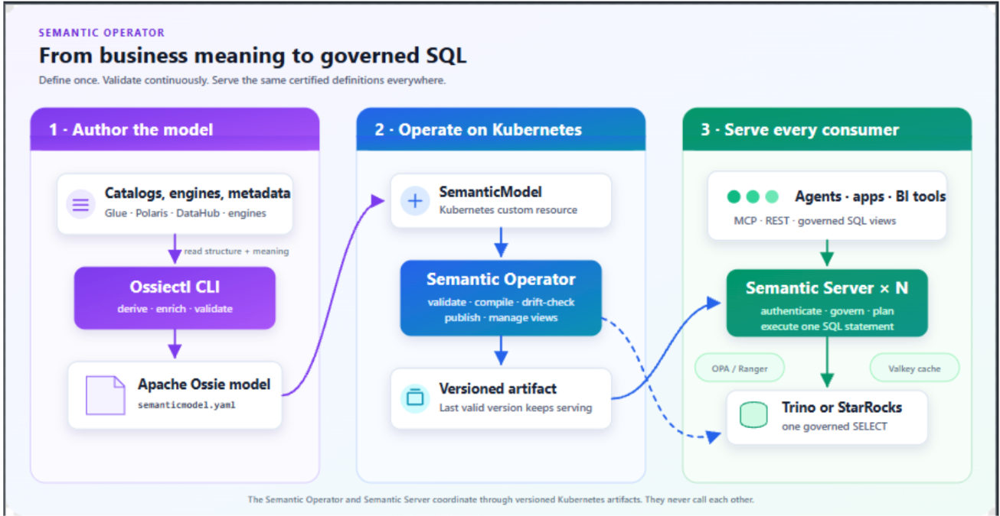

This is the first release candidate for Kubeflow Community Distribution 26.10. Please try it out and provide development feedback. For a stable and conservative experience, use the [latest stable release](https://github.com/kubeflow/community-distribution/releases/latest).

Release versioning is calendar-based (Year.Month.Patch). Around two base releases are [planned](https://github.com/kubeflow/community-distribution/blob/master/releases/kubeflow-community-distribution-release-handbook.md) per year, with optional patch releases. 
The [best-effort community support](https://www.kubeflow.org/docs/started/support/#support-from-the-kubeflow-community) is roughly six months, and [commercial support](https://www.kubeflow.org/docs/started/support/#support-from-commercial-providers-in-the-kubeflow-ecosystem) is available from multiple vendors. 
Please update regularly as explained in the [upgrading and extending section](https://github.com/kubeflow/community-distribution/blob/de767b82cd6b2d52abcb53d8f8038135338a370a/README.md#upgrading-and-extending) to benefit from security and performance improvements.

## Highlight features 26.10

- Experimental [Helm charts](https://medium.com/@danishsiddiqui040/why-kubeflow-helm-charts-took-more-than-writing-yaml-ad7ef203222e) providing a 1:1 equivalent of the Kustomize manifests, with [full Helm installation and end-to-end integration tests](https://github.com/kubeflow/community-distribution/actions/workflows/helm_kubeflow_integration_test.yaml) and Helm/Kustomize comparison tests.

- KinD 0.33.0 and Kubernetes 1.35-1.37.0 continuous integration tests.

- Kubeflow Workspaces 2.0.0-rc.1 (Notebooks v2) is enabled by default, with Workspaces entries in the Central Dashboard. Notebooks v1 remains optional. Kubeflow 27.03 will remove notebooks v1.

- Kubeflow Pipelines 2.18.0, with matching `kfp==2.18.0` and `kfp-kubernetes==2.18.0` packages. Separate version 1 SDK compatibility tests are retained. Kubeflow 27.03 will remove KFP v1 support. Kfp now supports proper [garbage collection not just for S3, but also the database](https://medium.com/@siddhantjainofficial26/gsoc-2026-platform-scalability-and-security-df71812c2563).

- Kubeflow Trainer 2.3.0, KServe 0.21.0, KServe UI 1.1.0, Kubeflow Hub 0.3.18 and Spark Operator 2.5.2.

- Istio 1.31.3, Knative Serving and Eventing 1.24.0, cert-manager 1.21.2, Dex 2.46.1 and OAuth2-Proxy 7.15.5. Knative Eventing remains optional.

- Spark Connect integration tests from a Kubeflow Workspace, improved component diagnostics, and security scanning migrated from Trivy to OSV-Scanner.

## Kubeflow Community Distribution:

* [Documentation updates](https://github.com/kubeflow/community-distribution/blob/master/README.md) that make it easier to install, extend and upgrade Kubeflow.

### Kubeflow Community Distribution 26.10

|Notebooks|Dashboard|Pipelines|Katib|Trainer|KServe|Model Registry|Spark|SDK|
| :------------------------------------------------------: | :---------------------------------------: | :--------------------------------------------------------: | :---------------------------------------: | :--------------------------------------------------------: | :---------------------------------------: | :--------------------------------------------------------: | :---------------------------------------: | :--------------------------------------------------------: |
| [1.11.0](https://github.com/kubeflow/notebooks/tree/v1.11.0/) | [v2.0.0](https://github.com/kubeflow/dashboard/tree/v2.0.0/) | [2.18.0](https://github.com/kubeflow/pipelines/tree/2.18.0/manifests/kustomize) |  |  | [v0.21.0](https://github.com/kserve/kserve/tree/v0.21.0) |  | [2.5.2](https://github.com/kubeflow/spark-operator/tree/v2.5.2) |  |

|Kubernetes|Argo|Kustomize|Cert Manager|Knative|Istio|Dex|OAuth2-proxy|
| :--------: | :----: | :-------: | :----------: | :-----: | :----: | :----: | :----------: |
|   |  |   |  [1.21.2](https://github.com/cert-manager/cert-manager/releases/tag/v1.21.2)   |   [v1.24.0](https://github.com/knative/serving/releases/tag/knative-v1.24.0) |  [1.31.3](https://github.com/istio/istio/releases/tag/1.31.3) | [2.46.1](https://github.com/dexidp/dex/releases/tag/v2.46.1) |  [7.15.5](https://github.com/oauth2-proxy/oauth2-proxy/releases/tag/v7.15.5) |

## [Pipelines](https://github.com/kubeflow/pipelines)

Kubeflow Pipelines introduces capabilities centered on automatic artifact previews, pipeline visualization, data management, and automated quality workflows:

- Automatic artifact previews: Supported Python components can generate Dataset and Model previews in run details, helping you inspect outputs without downloading the full artifact. #15087
- Clearer pipeline visualization: Nested sub-DAGs expand inline in the UI. Standalone HTML/Mermaid previews with local watch mode let you explore pipelines without deploying a server. #14864, #15064
- More authoring options: Components gain Kubernetes Dynamic Resource Allocation, init containers, Pydantic BaseModel inputs and outputs, and custom task cache keys. DRA requires a compatible backend, Kubernetes configuration, and resource driver. #14243, #13651, #13995, #13762
- Pipeline data management: Export/import transfers experiments, pipeline versions and tags, completed run history with MLMD lineage, and schedule definitions between compatible installations. Optional retention policies archive and delete expired completed runs; retention is disabled by default. #14659, #13532
- GitHub Agentic Workflows (gh-aw): Introduced automated issue triage and quality verification workflows using GitHub Agentic Workflows (gh-aw) to streamline review cycles, maintain contribution quality, and support maintainer velocity. . #13293, #14022, #14109, #14035

## [Training Operator (Trainer)](https://github.com/kubeflow/trainer)

## [Spark Operator](https://github.com/kubeflow/spark-operator)

### Spark Operator Community

We have a new name for our bi-weekly calls: “Spark on Kubernetes”!

- Meeting times: Bi-weekly on Friday @ 9:00 AM PST
- [Linux Foundation zoom link](https://zoom-lfx.platform.linuxfoundation.org/meeting/91692004209?password=e48ce50b-b41d-459a-9f32-7313fa388380)
- Join #kubeflow-spark-on-kubernetes Slack channel

## [KServe](https://github.com/kserve/kserve)

## [Dashboard](https://github.com/kubeflow/dashboard) and [Notebooks](https://github.com/kubeflow/notebooks)

###  Notebooks 

## What's New 

### Kubeflow Distribution Committee

As Kubeflow has graduated to a CNCF project and as it expands across enterprise platforms and hybrid environments, ensuring consistency, reliability, and smooth integration across individual subprojects has become critical. To address this, we are introducing the Kubeflow Distribution Committee (KDC), a vendor-neutral governance body dedicated to maintaining a robust and production-ready ecosystem. 

While the primary focus of the KDC is to empower the Kubeflow Subprojects as modular, high-quality components, the Kubeflow Community Distribution (KCD) serves as a primary example of this effort – providing a validated community-supported implementation that demonstrates the collective power of these projects in a unified platform.
The committee will only approve policies and decisions that support the following goals:

- Promote the Kubeflow community’s vision, values, and mission in collaboration with the KSC, KOC, and WG Chairs.
- Validate, report on, and advocate for the consumability of Kubeflow Subprojects by defining requirements for portability and ease of deployment across heterogeneous environments. This includes identifying integration-gaps such as unexposed configurations or packaging hurdles—and opening issues with maintainers to help prioritize improvements necessary for the Kubeflow Subprojects to be effectively integrated into the KCD and the broader vendor ecosystem.
- Define and maintain the requirements for external projects and distributions of Kubeflow Subprojects to be eligible to use the Kubeflow Conformant mark.
- Define and maintain the requirements for the Kubeflow Community Distribution. Subject to the KCD Decision Process.

### Semantic Operator

A Kubernetes operator and server that runs an Apache Ossie semantic layer on your existing data platform. You define each business metric once, in a SemanticModel resource. A deterministic compiler turns every request into exactly one governed SQL statement, so AI agents (over MCP), apps (over REST), and BI tools (over SQL views) all compute the metric the same way. The LLM only selects certified metrics and dimensions. It never writes SQL.

Here’s our architecture:

Many AI agents ask an LLM to generate SQL directly from a warehouse schema. The SQL can run successfully while using the wrong business definition. We measured both approaches across 30 business questions, with three phrasings each at temperature 0:

| Path | Accuracy | Consistency across phrasings | Wrong answers |
| --- | --- | --- | --- |
| Raw text-to-SQL | 62/90 (69%) | 19/30 (63%) | 28 |
| Semantic Layer | 87/90 (97%) | 27/30 (90%) | 3 |

Every raw-path miss executed without error and returned a confidently wrong number. Full results and method → https://kubeflow.github.io/semantic-operator/examples/benchmark-results/ 

Check out the project here: https://github.com/kubeflow/semantic-operator

### Kubeflow Docs Agent
Meet our FLO! 

The official LLM implementation of the Kubeflow Documentation Assistant powered by Retrieval-Augmented Generation (RAG).

Kubeflow users often struggle to find relevant information across the extensive documentation scattered across different services, components, and repositories. The traditional search approach lacks context and often returns irrelevant results. This documentation assistant addresses these challenges by:

- Semantic Search: Understanding the intent behind queries rather than just keyword matching
- Contextual Responses: Providing answers based on the most relevant documentation chunks
- Real-time Processing: Enabling instant responses through streaming APIs
- Scalable Architecture: Leveraging Kubernetes for automatic scaling and resource management

Check out the project here: https://github.com/kubeflow/docs-agent 

### Working-Group-Agents

## How to get started with 26.10

Visit the community distribution [release page](https://github.com/kubeflow/community-distribution/releases) or head over to the Getting Started and Support pages.

## Join the Community
Thank the kubeflow's release team, managers, working-group leads.

You can find more details about Kubeflow distributions
[here](https://www.kubeflow.org/docs/started/installing-kubeflow/#packaged-distributions).

## Want to help?

The Kubeflow community Working Groups hold open meetings and are always looking for more volunteers and users to unlock
the potential of machine learning. If you’re interested in becoming a Kubeflow contributor, please feel free to check
out the resources below. We look forward to working with you!

* Visit our [Kubeflow website](https://www.kubeflow.org/docs/about/community/) or Kubeflow GitHub Page.
* Join the [Kubeflow Slack channel](https://www.kubeflow.org/docs/about/community/).
* Join the [kubeflow-discuss](https://groups.google.com/g/kubeflow-discuss) mailing list.
* Attend our weekly [community meeting](https://www.kubeflow.org/docs/about/community/#kubeflow-community-call).
