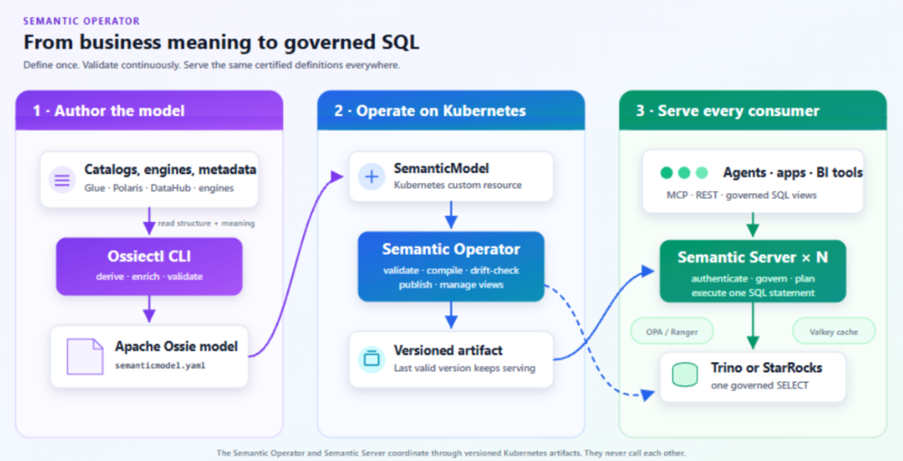

Release versioning is calendar-based (Year.Month.Patch). Around two base releases are [planned](https://github.com/kubeflow/community-distribution/blob/master/releases/kubeflow-community-distribution-release-handbook.md) per year, with optional patch releases. 
The [best-effort community support](https://www.kubeflow.org/docs/started/support/#support-from-the-kubeflow-community) is roughly six months, and [commercial support](https://www.kubeflow.org/docs/started/support/#support-from-commercial-providers-in-the-kubeflow-ecosystem) is available from multiple vendors. 
Please update regularly as explained in the [upgrading and extending section](https://github.com/kubeflow/community-distribution/blob/de767b82cd6b2d52abcb53d8f8038135338a370a/README.md#upgrading-and-extending) to benefit from security and performance improvements.

## Highlight features 26.10

- **[Helm charts](https://medium.com/@danishsiddiqui040/why-kubeflow-helm-charts-took-more-than-writing-yaml-ad7ef203222e) (_experimental_):** The charts provide a 1:1 equivalent of the Kustomize manifests, with [full Helm installation and end-to-end integration tests](https://medium.com/@danishsiddiqui040/why-kubeflow-helm-charts-took-more-than-writing-yaml-ad7ef203222e).

- **Kubernetes Versions:** We have support for versions 1.35-1.37.0 as validated via CI/CD.
- **Kubeflow Workspaces 2.0.0 (Notebooks v2)** as the new major release is now enabled by default, with Workspaces entries in the Central Dashboard. Notebooks v1 remains optional and is scheduled for removal in Kubeflow 27.03.
- **Kubeflow Notebooks v1.11.1** fixes the [infinite status reconciliation loop in the notebook controller](https://github.com/kubeflow/notebooks/pull/1343), improving scalability for existing Notebooks v1 installations.
- **Kubeflow Dashboard 2.0.1** includes many dependency and security updates, navigation fixes and self-service viewer management. See the [Dashboard release notes](https://github.com/kubeflow/dashboard/releases/tag/v2.0.1).
- **Kubeflow Pipelines 2.18.0**, with matching python packages. The version 1 SDK compatibility tests are retained, note however that KFP v1 support is scheduled for removal in Kubeflow 27.03. Pipelines now supports [garbage collection for both S3 artifacts and the database](https://medium.com/@siddhantjainofficial26/gsoc-2026-platform-scalability-and-security-df71812c2563).
- **Kubeflow Trainer 2.4.0** with support for OptimizationJobs, TrainJobs, Katib replacement
- **Istio 1.31.3**, Knative Serving and Eventing 1.24.0, cert-manager 1.21.2, Dex 2.46.1 and OAuth2-Proxy 7.15.5. Knative Eventing remains optional.
- **Interactive Spark Connect integration tests** from a Kubeflow Workspace, improved component diagnostics, and security scanning migrated from Trivy to OSV-Scanner.

## Kubeflow Community Distribution:

* [Documentation updates](https://github.com/kubeflow/community-distribution/blob/master/README.md) that make it easier to install, extend and upgrade Kubeflow.

### Kubeflow Community Distribution 26.10.0

|Notebooks|Dashboard|Pipelines|Katib|Trainer|KServe|Model Registry|Spark|SDK|
| :------------------------------------------------------: | :---------------------------------------: | :--------------------------------------------------------: | :---------------------------------------: | :--------------------------------------------------------: | :---------------------------------------: | :--------------------------------------------------------: | :---------------------------------------: | :--------------------------------------------------------: |
| [2.0.0](https://github.com/kubeflow/notebooks/tree/v2.0.0/) | [v2.0.1](https://github.com/kubeflow/dashboard/tree/v2.0.1/) | [2.18.0](https://github.com/kubeflow/pipelines/tree/2.18.0/manifests/kustomize) |  |  | [v0.21.0](https://github.com/kserve/kserve/tree/v0.21.0) |  | [2.5.2](https://github.com/kubeflow/spark-operator/tree/v2.5.2) |  |

|Kubernetes|Argo|Kustomize|Cert Manager|Knative|Istio|Dex|OAuth2-proxy|
| :--------: | :----: | :-------: | :----------: | :-----: | :----: | :----: | :----------: |
|   |  |   |  [1.21.2](https://github.com/cert-manager/cert-manager/releases/tag/v1.21.2)   |   [v1.24.0](https://github.com/knative/serving/releases/tag/knative-v1.24.0) |  [1.31.3](https://github.com/istio/istio/releases/tag/1.31.3) | [2.46.1](https://github.com/dexidp/dex/releases/tag/v2.46.1) |  [7.15.5](https://github.com/oauth2-proxy/oauth2-proxy/releases/tag/v7.15.5) |

## [Pipelines](https://github.com/kubeflow/pipelines)
## 🚀 Features
Kubeflow Pipelines introduces capabilities centered on automatic artifact previews, pipeline visualization, data management, and automated quality workflows:

- **Automatic artifact previews:** Supported Python components can generate Dataset and Model previews in run details, helping you inspect outputs without downloading the full artifact. [#15087](https://github.com/kubeflow/pipelines/pull/15087)
- **Clearer pipeline visualization:** Nested sub-DAGs expand inline in the UI. Standalone HTML/Mermaid previews with local watch mode let you explore pipelines without deploying a server. [#14864](https://github.com/kubeflow/pipelines/pull/14864), [#15064](https://github.com/kubeflow/pipelines/pull/15064)
- **More authoring options:** Components gain Kubernetes Dynamic Resource Allocation, init containers, Pydantic BaseModel inputs and outputs, and custom task cache keys. DRA requires a compatible backend, Kubernetes configuration, and resource driver. [#14243](https://github.com/kubeflow/pipelines/pull/14243), [#13651](https://github.com/kubeflow/pipelines/pull/13651), [#13995](https://github.com/kubeflow/pipelines/pull/13995), [#13762](https://github.com/kubeflow/pipelines/pull/13762)
- **Pipeline data management:** Export/import transfers experiments, pipeline versions and tags, completed run history with MLMD lineage, and schedule definitions between compatible installations. Optional retention policies archive and delete expired completed runs; retention is disabled by default. [#14659](https://github.com/kubeflow/pipelines/pull/14659), [#13532](https://github.com/kubeflow/pipelines/pull/13532)
- **GitHub Agentic Workflows (gh-aw):** Introduced automated issue triage and quality verification workflows using GitHub Agentic Workflows (gh-aw) to streamline review cycles, maintain contribution quality, and support maintainer velocity. . [#13293](https://github.com/kubeflow/pipelines/pull/13293), [#14022](https://github.com/kubeflow/pipelines/pull/14022), [#14109](https://github.com/kubeflow/pipelines/pull/14109), [#14035](https://github.com/kubeflow/pipelines/pull/14035)

## [Training Operator (Trainer)](https://github.com/kubeflow/trainer)

This release Kubeflow Trainer focussed on scheduling, observations, and monitoring through Workload Aware Scheduling, Dynamic Resource Allocation. We also introduced a new CRD - OptimizationJob Controller which is in alpha stage currently. We aim to deprecate Katib as well.

## 🚀 Features

**Workload-Aware Scheduling**

This feature introduced integrating the Kubernetes Workload API into Kubeflow Trainer to enable
native workload aware scheduling for TrainJobs. The Workload API, introduced in Kubernetes v1.35 (alpha)
and promoted to beta in Kubernetes v1.37, provides multiple features to enhance AI workload scheduling orchestration including:  
- gang-scheduling: [KEP-4671](https://github.com/kubernetes/enhancements/tree/master/keps/sig-scheduling/4671-gang-scheduling),
- topology-aware scheduling: [KEP-5732](https://github.com/kubernetes/enhancements/tree/master/keps/sig-scheduling/5732-topology-aware-workload-scheduling),
- DRA: [KEP-5729](https://github.com/kubernetes/enhancements/tree/master/keps/sig-scheduling/5729-resourceclaim-support-for-workloads),
and other features through the Workload and PodGroup resources.

**OptimizationJob API**

Implement the full API schema for OptimizationJob, CEL and Webhook validation rules. Moving from Katib legacy Experiment CRD to OptimizationJob CRD.

By integrating OptimizationJob natively under the trainer.kubeflow.org API group, we unify the user experience and enable shared observability with TrainJobs.

Key features of this API schema: CEL-Native Validation, Declarative HPO, Manifests & Tooling.

**Dynamic Resource Allocation**

`Dynamic Resource Allocation (DRA)` graduated to GA in Kubernetes 1.34, providing a modern alternative to extended resources for GPUs and accelerators. 
This KEP adds a top-level `resourceClaimsPerNode` field on Trainer, next to `resourcesPerNode`, so data scientists can request DRA devices with the same UX they already use for CPU/memory/GPU counts. The controller applies these claims to the trainer node PodSpec and wires container-level resources.claims on the node container. 
Claims for other containers (sidecars, init containers) are configured via the runtimePatches API. It also updates GPU auto-detection so numProcPerNode continues to work with DRA.

Here's the KEP for this feature:
- KEP-2782: Dynamic Resource Allocation support for TrainJob [#3540](https://github.com/kubeflow/trainer/pull/3540)

**Scheduling & Integrations:**
- Allow users to select a scheduler per TrainJob through the existing RuntimePatches API, without duplicating or modifying a shared TrainingRuntime.
[#4265](https://github.com/kubeflow/trainer/pull/4265)

- JobSet previously supported multi-slice TPU with replica corresponds to the number of slices
`parallelism` corresponds to the number hosts in a single slice. There should be an easy to use way to specify these params for multi-TPU training jobs.
[#4250](https://github.com/kubeflow/trainer/pull/4250)

- We introduced a new `ComponentDeleterPlugin` interface in Kubeflow Trainer to automatically delete Volcano PodGroup resources when a TrainJob enters a Failed, Complete, or suspended state. 

- Previously, PodGroup objects remained in the cluster and permanently held onto `minResources` in the Volcano queue, blocking other jobs from running. 

- The update also prevents the Volcano plugin from recreating the PodGroup while a job is suspended avoiding a create-delete loop and ensures a fresh PodGroup is built cleanly upon resumption. Additionally, it adds the required RBAC delete permissions for Volcano PodGroup resources and updates the Makefile to properly fetch the Volcano CRD for integration tests.
[#4059](https://github.com/kubeflow/trainer/pull/4059)  

- An opt-in Prometheus monitoring support for the Kubeflow Trainer controller by enabling metric scraping via Prometheus Operator.
Key changes includes Kustomize & Helm Integration, Security & Authentication, RBAC Parity, Scope focuses strictly on making existing controller-runtime metrics scrapeable rather than introducing new Trainer-specific metrics.
[#4102](https://github.com/kubeflow/trainer/pull/4102)

- We added operator documentation for scheduling TrainJob workloads using slurm-bridge on hybrid Kubernetes and Slurm clusters.
Key highlights include: New Operator Guide, Scheduler Integration Scope, Setup & Usage Details
[#3951](https://github.com/kubeflow/trainer/pull/3951)

## [Spark Operator](https://github.com/kubeflow/spark-operator)
### Spark Operator Community

We have a new name for our bi-weekly calls: “Spark on Kubernetes”!

- Meeting times: Bi-weekly on Friday @ 9:00 AM PST
- [Linux Foundation zoom link](https://zoom-lfx.platform.linuxfoundation.org/meeting/91692004209?password=e48ce50b-b41d-459a-9f32-7313fa388380)
- Join #kubeflow-spark-on-kubernetes Slack channel

## [KServe](https://github.com/kserve/kserve)
## 🚀 Features
- LLMInferenceService Enchancements
   - Direct KEDA Autoscaling and Scale-to-Zero
   - Traffic Splitting for Controlled Deployments
   - KV Cache Offloading
   - Static LoRA Adapter Support
   - LocalModelCache Support
[Source](https://kserve.github.io/website/blog/kserve-0.21-release)

- KServe UI

The [KServe UI](https://github.com/kserve/models-web-app) is a component of KServe that provides a user-friendly way to handle the lifecycle of InferenceService CRs in a Kubeflow cluster. This allows users to create, delete, and inspect the state of their Model Servers without needing to interact with Kubernetes resources directly.

## Workspaces and Dashboard
- Kubeflow Workspaces is the next generation of Kubeflow Notebooks, replacing the original Notebooks controller with a more flexible and extensible architecture.
- Kubeflow Workspaces 2.0.0 (Notebooks v2) is enabled by default, with Workspaces entries in the Central Dashboard. Notebooks v1 remains optional and is scheduled for removal in Kubeflow 27.03.
- Kubeflow Notebooks v1.11.1 fixes the [infinite status reconciliation loop in the notebook controller](https://github.com/kubeflow/notebooks/pull/1343), improving scalability for existing Notebooks v1 installations.
- Kubeflow Dashboard 2.0.1 includes many dependency and security updates, navigation fixes and self-service viewer management. See the [Dashboard release notes](https://github.com/kubeflow/dashboard/releases/tag/v2.0.1).

## What's New 

### Kubeflow Distribution Committee

As Kubeflow has graduated to a CNCF project and as it expands across enterprise platforms and hybrid environments, ensuring consistency, reliability, and smooth integration across individual subprojects has become critical. To address this, we are introducing the Kubeflow Distribution Committee (KDC), a vendor-neutral governance body dedicated to maintaining a robust and production-ready ecosystem. 

While the primary focus of the KDC is to empower the Kubeflow Subprojects as modular, high-quality components, the Kubeflow Community Distribution (KCD) serves as a primary example of this effort – providing a validated community-supported implementation that demonstrates the collective power of these projects in a unified platform.
The committee will only approve policies and decisions that support the following goals:

- Promote the Kubeflow community’s vision, values, and mission in collaboration with the KSC, KOC, and WG Chairs.
- Validate, report on, and advocate for the consumability of Kubeflow Subprojects by defining requirements for portability and ease of deployment across heterogeneous environments. This includes identifying integration-gaps such as unexposed configurations or packaging hurdles—and opening issues with maintainers to help prioritize improvements necessary for the Kubeflow Subprojects to be effectively integrated into the KCD and the broader vendor ecosystem.
- Define and maintain the requirements for external projects and distributions of Kubeflow Subprojects to be eligible to use the Kubeflow Conformant mark.
- Define and maintain the requirements for the Kubeflow Community Distribution. Subject to the KCD Decision Process.

### Semantic Operator

A Kubernetes operator and server that runs an Apache Ossie semantic layer on your existing data platform. You define each business metric once, in a SemanticModel resource. A deterministic compiler turns every request into exactly one governed SQL statement, so AI agents (over MCP), apps (over REST), and BI tools (over SQL views) all compute the metric the same way. The LLM only selects certified metrics and dimensions. It never writes SQL.

Here’s our architecture:

Many AI agents ask an LLM to generate SQL directly from a warehouse schema. The SQL can run successfully while using the wrong business definition. We measured both approaches across 30 business questions, with three phrasings each at temperature 0:

| Path | Accuracy | Consistency across phrasings | Wrong answers |
| --- | --- | --- | --- |
| Raw text-to-SQL | 62/90 (69%) | 19/30 (63%) | 28 |
| Semantic Layer | 87/90 (97%) | 27/30 (90%) | 3 |

Every raw-path miss executed without error and returned a confidently wrong number. Full results and method → https://kubeflow.github.io/semantic-operator/examples/benchmark-results/ 

- Check out the project: https://github.com/kubeflow/semantic-operator

- Check out the blog: https://blog.kubeflow.org/introducing-semantic-operator/

### Kubeflow Docs Agent 
Meet our Project FLO!                                   

**Who FLO is?**

Flo is an agentic RAG (Retrieval-Augmented Generation) documentation assistant built to power the Kubeflow website.
Developed within the kubeflow/docs-agent repository by open-source maintainers including [Santhosh_t](https://github.com/SanthoshToorpu) and [Rohit Kumar](https://github.com/kmr-rohit) (who heavily developed the “Flo” persona during a Google Summer of Code 2026 project), it serves as the official LLM-powered assistant for the community.
Flo aligns directly with the architectural goals of the `Kubeflow Agents Working Group (WG-Agents)`, serving as a practical implementation of autonomous agentic workflows and Model Context Protocol (MCP) server integrations on Kubernetes. Rather than relying on standard text search, Flo uses these MCP toolsets and hybrid retrieval (combining dense vector embeddings with `BM25` sparse retrieval via a Milvus vector database) to pull context from across the entire Kubeflow surface—including prose documentation, GitHub issues, source code, and deployment manifests.

**Key technical capabilities of the Flo agent include:**

- **Production GitOps & Evals:** The agent is managed and deployed using Argo CD GitOps workflows. When changes are merged to the docs-agent repository, a staging step runs an LLM-as-a-judge evaluation dataset (logging telemetry to Langfuse) so that every update is scored for quality before reaching production. 
- **Automated Issue Triage:** Beyond answering website queries, Flo’s underlying retrieval engine is equipped with instruction and label sets to automatically triage new GitHub issues based on its documentation grounding. 
- **Cloud-Native Serving:** Operating entirely within Kubernetes environments, it utilizes models like Llama 3.1 or Gemma and leverages KServe inference services with WebSocket and HTTP streaming for real-time, bidirectional communication with users.

Kubeflow users often struggle to find relevant information across the extensive documentation scattered across different services, components, and repositories. The traditional search approach lacks context and often returns irrelevant results. This documentation assistant addresses these challenges by:

- Semantic Search: Understanding the intent behind queries rather than just keyword matching
- Contextual Responses: Providing answers based on the most relevant documentation chunks
- Real-time Processing: Enabling instant responses through streaming APIs
- Scalable Architecture: Leveraging Kubernetes for automatic scaling and resource management

Check out the project here: https://github.com/kubeflow/docs-agent 

### Working-Group-Agents
This newly introduced WG focuses on deploying and operationalizing autonomous agentic workflows within Kubeflow.
Join our slack community: [wg-agents-slack](https://kubeflow.slack.com/messages/kubeflow-wg-agents)

## How to get started with 26.10

Visit the community distribution [release page](https://github.com/kubeflow/community-distribution/releases) or head over to the Getting Started and Support pages.

## Join the Community
We would like to thank everyone who contributed to Kubeflow 26.10, and especially [Dominik Kawka](https://github.com/dominikkawka) for his work as the v26.10 Release Manager. 

We also extend our thanks to the entire release team and the working group leads, who continuously and generously dedicate their time and expertise to Kubeflow.

Release team members : [Dominik Kawka](https://github.com/dominikkawka), [Dhanisha Phadate](https://github.com/dhanishaphadate), [Alyssa Goins](https://github.com/alyssacgoins), [Artur Martins](https://github.com/arturmartins), [Tarek Abouzeid](https://github.com/tarekabouzeid),  [Vikas Saxena](https://github.com/vikas-saxena02), [Adysen Rothman](https://github.com/adysenrothman), [Vraj Bhatt](https://github.com/vrajjbhatt), [Shristi](https://github.com/modichika), [Rob Bell](https://github.com/robert-bell), [Christian Heusel](https://github.com/christian-heusel), [Manabu McClosley](https://github.com/nabuskey)

Kubeflow Steering Committee : [Andrey Velichkevich](https://github.com/andreyvelich), [Chase Christensen](https://github.com/chasecadet), [Francisco Arceo](https://github.com/franciscojavierarceo), [Julius von Kohout](https://github.com/juliusvonkohout), [Mathew Wicks](https://github.com/thesuperzapper)

You can find more details about Kubeflow distributions
[here](https://www.kubeflow.org/docs/started/installing-kubeflow/#packaged-distributions).

## Want to help?

The Kubeflow community Working Groups hold open meetings and are always looking for more volunteers and users to unlock
the potential of machine learning. If you’re interested in becoming a Kubeflow contributor, please feel free to check
out the resources below. We look forward to working with you!

* Visit our [Kubeflow website](https://www.kubeflow.org/docs/about/community/) or Kubeflow GitHub Page.
* Join the [Kubeflow Slack channel](https://www.kubeflow.org/docs/about/community/#kubeflow-slack-channels).
* Join the [kubeflow-discuss](https://groups.google.com/g/kubeflow-discuss) mailing list.
* Attend our weekly [community meeting](https://www.kubeflow.org/docs/about/community/#kubeflow-community-call).
